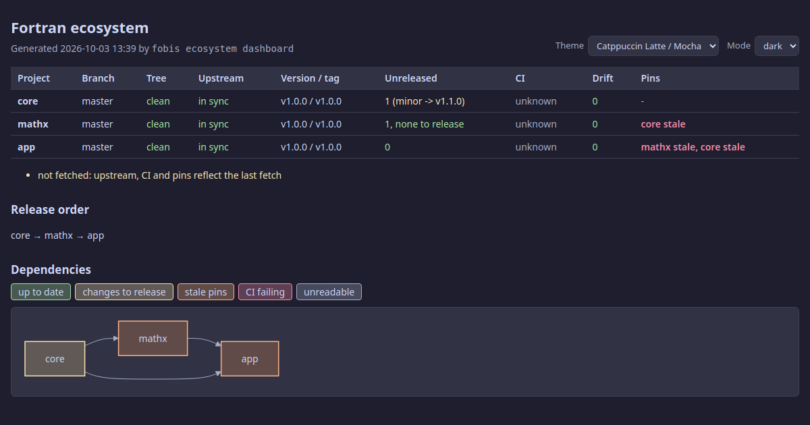

<div align="center">

# FoBiS — Fortran Building System

[](https://pypi.org/project/FoBiS.py/)
[]()
[](https://github.com/szaghi/FoBiS/actions)
[](https://szaghi.github.io/FoBiS/)
[]()
[]()

[]()

> Automatic dependency-resolving build tool for modern Fortran projects — no makefiles, no boilerplate.
> Package manger highly integrated with GitHub, install and fetch project dependencies.
> Add instrospective doctests to your Fortran project and exploit AI-powered programmatic buildings with the provided AI skill.
> Manage a whole ecosystem of interconnected repositories: dashboard, cross-repo checks, release train.

<div>
<table>
<tr>
<td><b>⚡ Zero-configuration builds</b><br><sub>Drop FoBiS into any Fortran project and run <code>fobis build</code>. It scans sources, resolves all <code>use</code>, <code>include</code>, and module dependencies automatically, and compiles in the correct order — no makefiles, no boilerplate. Convention-based discovery finds <code>src/</code>, <code>source/</code>, and <code>app/</code> directories automatically. <a href="https://szaghi.github.io/FoBiS/tutorial/first-steps/01-first-build">First tutorial</a></sub></td>
<td><b>📄 fobos — the FoBiS makefile</b><br><sub>A concise INI-style configuration file replaces makefiles entirely. Define multiple build modes, templates, variables, custom rules, feature flags, multi-target sections, and hooks — all in one readable file. <a href="https://szaghi.github.io/FoBiS/fobos/">fobos reference</a></sub></td>
</tr>
<tr>
<td><b>🌐 GitHub integration</b><br><sub>Declare dependencies in a <code>[dependencies]</code> fobos section — <code>fobis fetch</code> clones, pins to branch/tag/rev/semver, and pre-builds them; <code>fobis build</code> picks them up automatically. The commits fetched are recorded in a lock file next to the dependencies. Install any GitHub-hosted FoBiS project directly with <code>fobis install user/repo</code>. <a href="https://szaghi.github.io/FoBiS/cookbook/dependencies">Fetch deps</a> · <a href="https://szaghi.github.io/FoBiS/cookbook/dependencies#the-lock-file">Lock file</a></sub></td>
<td><b>🏗️ Named build profiles &amp; feature flags</b><br><sub>One-word compiler flag presets (<code>debug</code>, <code>release</code>, <code>asan</code>, <code>coverage</code>) for every supported compiler. Feature flags let you activate named compile-time options without separate build modes — mix and match freely. <a href="https://szaghi.github.io/FoBiS/cookbook/build#debug-and-release-builds">Build profiles</a> · <a href="https://szaghi.github.io/FoBiS/cookbook/build#switch-options-on-and-off-features">Feature flags</a></sub></td>
</tr>
<tr>
<td><b>🧪 Integrated test runner &amp; coverage</b><br><sub><code>fobis test</code> discovers, compiles, and runs all Fortran test programs — no external harness needed. <code>fobis coverage</code> generates HTML/XML reports via gcovr or lcov and can fail CI when coverage drops below a threshold. <a href="https://szaghi.github.io/FoBiS/cookbook/testing">Test runner</a> · <a href="https://szaghi.github.io/FoBiS/reference/coverage">Coverage</a></sub></td>
<td><b>🔬 Introspective doctests</b><br><sub>Embed micro-unit-tests directly inside Fortran comment docstrings. FoBiS generates, compiles, and runs volatile test programs automatically — inspired by Python's doctest module, no test harness needed. <a href="https://szaghi.github.io/FoBiS/cookbook/testing#doctests-checks-in-the-documentation">Doctests</a></sub></td>
</tr>
<tr>
<td><b>⚡ Incremental builds</b><br><sub>Only what changed is compiled again: a source newer than its object, the users of a module whose interface changed, everything when the flags or the compiler change. Compiles in parallel, in dependency order. <a href="https://szaghi.github.io/FoBiS/cookbook/build#what-is-compiled-again">What is compiled again</a></sub></td>
<td><b>🤖 Introspect &amp; Claude Code skill</b><br><sub><code>fobis introspect --all</code> emits machine-readable JSON of the full project graph — sources, compiler flags, dependencies, targets. Powers the bundled <code>/fobis</code> Claude Code skill for AI-assisted builds right in your editor. <a href="https://szaghi.github.io/FoBiS/reference/introspect">introspect</a> · <a href="https://szaghi.github.io/FoBiS/cookbook/ai-setup#the-claude-code-skill">Claude skill</a></sub></td>
</tr>
<tr>
<td><b>📋 Scaffold — boilerplate sync</b><br><sub>Keep CI workflows, docs configs, license files, and scripts identical across all your Fortran repos. <code>fobis scaffold status</code> shows drift; <code>fobis scaffold sync</code> fixes it; <code>fobis scaffold init</code> bootstraps new projects. All templates bundled inside FoBiS — no extra dependencies. <a href="https://szaghi.github.io/FoBiS/reference/scaffold">Scaffold reference</a></sub></td>
<td><b>🧠 LLM commit messages</b><br><sub>Generate well-formed <a href="https://www.conventionalcommits.org/">Conventional Commits</a> messages for staged changes via a local LLM. Supports <a href="https://ollama.com">Ollama</a> and any OpenAI-compatible endpoint (LM Studio, vLLM, llama.cpp) — no cloud account, no API key, no data leaving your machine. <a href="https://szaghi.github.io/FoBiS/cookbook/ai#commit-messages">LLM commit guide</a></sub></td>
</tr>
<tr>
<td><b>🧭 Ecosystem dashboard</b><br><sub>Register your interconnected repositories once; <code>fobis ecosystem dashboard</code> shows them all at a glance — releases due (bump suggested from Conventional Commits), CI at HEAD, scaffold drift, dependency pins behind the upstream heads — in the terminal or as a themed HTML page with a live dependency diagram. <a href="https://szaghi.github.io/FoBiS/cookbook/ecosystem">Ecosystem guide</a></sub></td>
<td><b>🚂 Check &amp; release train</b><br><sub><code>fobis ecosystem check LIB</code> builds and tests every project downstream against your local, unreleased working copy. <code>fobis ecosystem release</code> releases everything due, dependencies first, refusing to start while any project is blocked and stopping safely at the first failure. <a href="https://szaghi.github.io/FoBiS/reference/ecosystem">ecosystem reference</a></sub></td>
</tr>
<tr>
<td><b>🔎 Code quality</b><br><sub><code>fobis lint</code> checks the sources with rules for bug-prone, obsolescent and non-portable code and for OpenMP, OpenACC and MPI defects; <code>fobis review</code> reports only on the lines a change touches; <code>fobis query</code> answers who calls, writes or offloads what; <code>fobis modernize</code> applies fixes only when builds, tests and cases are unchanged. <a href="https://szaghi.github.io/FoBiS/tutorial/quality/01-lint">Code quality track</a></sub></td>
<td><b>📐 Verified numerics</b><br><sub>Declare cases and the quantities they compute; <code>fobis verify</code> compares them with accepted references within declared tolerances, <code>fobis matrix</code> across compilers and checked builds, <code>fobis assess</code> estimates the digits you can trust, <code>fobis diff-run</code> and <code>fobis bench</code> compare two revisions, <code>fobis gate</code> runs them all, locally or under Slurm. <a href="https://szaghi.github.io/FoBiS/tutorial/numerics/01-cases">Verified numerics track</a></sub></td>
</tr>
<tr>
<td colspan="2"><b>📚 Packages by name, no central server</b><br><sub>Package indexes list Fortran projects by source URL; anyone can publish one and FoBiS reads several side by side. <code>fobis search</code> finds a package by name or by the module you need, <code>fobis add</code> writes its source URL into your fobos (builds never read an index), <code>fobis pkg install</code> builds it with your compiler and installs it with a pkg-config file. Any URL can host code: git on any host, or a static directory of releases. A public index of FoBiS and fpm packages: <a href="https://github.com/szaghi/fortran-index">fortran-index</a> (<a href="https://szaghi.github.io/fortran-index/packages/">browse</a>). <a href="https://szaghi.github.io/FoBiS/cookbook/packages">Packages and indexes</a></sub></td>
</tr>
<tr>
<td colspan="2"><b>🧠 AI assistance, grounded</b><br><sub>Local open models managed by FoBiS explain build failures and crashes, answer questions about the code with citations, generate tests that must build and pass, review changes and propose merge resolutions checked by the compiler; <code>fobis mcp</code> serves the same facts to AI agents. Facts first, model last. <a href="https://szaghi.github.io/FoBiS/cookbook/ai">The AI design</a></sub></td>
</tr>
</table>
</div>

**[Full documentation](https://szaghi.github.io/FoBiS/)**: [tutorials](https://szaghi.github.io/FoBiS/tutorial/) · [cookbook](https://szaghi.github.io/FoBiS/cookbook/) · [reference](https://szaghi.github.io/FoBiS/reference/)

</div>

## Why FoBiS?

Modern Fortran's module system is powerful — but tracking inter-module compilation order by hand in a makefile quickly becomes a nightmare as project size grows. Every time you add a module, rename a file, or restructure directories, the makefile needs manual updates.

**FoBiS solves this completely.** It parses source files on every invocation, rebuilds the dependency graph from scratch, and compiles in the correct order — with no configuration required for simple projects.

```bash
# That's it. FoBiS finds all programs, resolves all dependencies, compiles.
fobis build
```

Starting from nothing, `fobis new` writes a project that builds and tests at once:

```bash
fobis new demo && cd demo && fobis build && fobis test
```

For complex projects, a single `fobos` file in the project root replaces makefiles entirely:

```ini
[modes]
modes = debug release

[debug]
compiler  = gnu
cflags    = -c -O0 -g -Wall
build_dir = ./build/debug/

[release]
compiler  = gnu
cflags    = -c -O3
build_dir = ./build/release/
```

```bash
fobis build --mode release
```

| **zero-configuration build** | **simplify complex dependency** |
|:---:|:---:|
|  |  |
| **GH integration, project install** | **GH integration, dependancies fetch** |
|  |  |
| **ecosystem: graph and dashboard** | **ecosystem: check before releasing** |
|  |  |

## Packages — find, add and install by name

A package index is a small file listing Fortran projects by their source URL. There is no central server: anyone
publishes one, FoBiS reads several side by side, and builds never read them. [fortran-index](https://github.com/szaghi/fortran-index)
is a public index of FoBiS and fpm packages ([catalogue](https://szaghi.github.io/fortran-index/packages/)).

```bash
fobis index add szaghi https://github.com/szaghi/fortran-index
fobis search --module m_cli2                # who provides a module
fobis add json-fortran                      # writes the source URL and a version range into your fobos
fobis fetch && fobis build
fobis pkg install M_strings                 # built with your compiler, installed with a pkg-config file
```

See [Packages and indexes](https://szaghi.github.io/FoBiS/cookbook/packages) for publishing your own index, releases
on any static host, CMake and make packages, and dependencies of dependencies.

## Ecosystem — manage interconnected projects

Several Fortran libraries, each in its own repository, depending on each other? Register them once and `fobis ecosystem` handles them as a whole — read-only unless you ask it to act, and nothing is ever pushed without your confirmation.

```bash
fobis ecosystem discover                    # FoBiS repos under your root not registered yet
fobis ecosystem add PENF FACE BeFoR64       # register them (your config keeps its comments)
fobis ecosystem graph                       # release order and dependency tree
fobis ecosystem dashboard                   # releases due, CI, drift, stale pins (--format html for a page)
fobis ecosystem exec -- 'fobis clean && fobis build'   # any command, every project, dependencies first
fobis ecosystem check PENF                  # does my local PENF break anything downstream?
fobis ecosystem release --dry-run           # what needs a release, with which version
fobis ecosystem release                     # the release train
```



| **pre-release impact check** | **release train** |
|:---:|:---:|
|  |  |

See the [ecosystem guide](https://szaghi.github.io/FoBiS/cookbook/ecosystem) for the concepts, a one-minute demo you can run locally, and recipes.

## Scaffold — boilerplate management

`fobis scaffold` keeps CI workflows, docs configs, license files, and other boilerplate in sync across all your Fortran repos. All templates are bundled inside FoBiS — no external dependencies.

```bash
fobis scaffold status          # drift report: OK / OUTDATED / MISSING per file
fobis scaffold sync --dry-run  # preview diffs without writing
fobis scaffold sync --yes      # apply all updates silently
fobis scaffold init            # bootstrap a new project (creates src/, docs/, .github/, …)
fobis scaffold list            # list all managed files and their categories
```

Project variables (`{{NAME}}`, `{{AUTHORS}}`, `{{REPOSITORY}}`, …) are resolved from the fobos `[project]` section, the git remote URL, and `git config`. See the [scaffold reference](https://szaghi.github.io/FoBiS/reference/scaffold) for full details.

## AI assistance, on your machine

FoBiS runs open models itself — llama.cpp's server, a pinned release, and a model pulled once — so there is no
service to install, no account, and no code leaving the machine. Every answer is built on the project's facts
(the compiler's message, the code, the interfaces) and cites the sources it comes from.

```bash
fobis llm runtime install && fobis llm pull coder-7b   # once
fobis build --explain     # why the build failed: facts first, then a cited cause and fix
fobis ask -p src "What does simpson require of the number of intervals?"
fobis commit              # a Conventional Commits message for the staged changes
```


Recorded with coder-7b on 6 CPU cores and no GPU: each answer takes about 45 s there (cut from the recording),
a few seconds on a GPU. Ollama and any OpenAI-compatible server work too. Guides:
[explaining failures](https://szaghi.github.io/FoBiS/cookbook/ai#why-the-build-failed), [asking questions](https://szaghi.github.io/FoBiS/cookbook/ai#ask-about-the-code-and-the-standards),
[commit messages](https://szaghi.github.io/FoBiS/cookbook/ai#commit-messages), [the local runtime](https://szaghi.github.io/FoBiS/cookbook/ai-setup).

## Showcases

> Projects using FoBiS:

- **[ADAM](https://szaghi.github.io/adam/)** — Accelerated fluid Dynamics on Adaptive Mesh refinement grids &nbsp;|&nbsp; [GitHub](https://github.com/szaghi/adam)
- **[BeFoR64](https://szaghi.github.io/BeFoR64/)** — Base64 encoding/decoding library for Fortran &nbsp;|&nbsp; [GitHub](https://github.com/szaghi/BeFoR64)
- **[FACE](https://szaghi.github.io/FACE/)** — Fortran ANSI Colors and Escape sequences &nbsp;|&nbsp; [GitHub](https://github.com/szaghi/FACE)
- **[FiNeR](https://szaghi.github.io/FiNeR/)** — Fortran INI ParseR and generator &nbsp;|&nbsp; [GitHub](https://github.com/szaghi/FiNeR)
- **[FLAP](https://szaghi.github.io/FLAP/)** — Fortran command Line Arguments Parser &nbsp;|&nbsp; [GitHub](https://github.com/szaghi/FLAP)
- **[FUNDAL](https://szaghi.github.io/FUNDAL/)** — Fortran UNified Device Acceleration Library &nbsp;|&nbsp; [GitHub](https://github.com/szaghi/FUNDAL)
- **[FOSSIL](https://szaghi.github.io/FOSSIL/)** — FOrtran Stereo (si) Litography parser &nbsp;|&nbsp; [GitHub](https://github.com/szaghi/FOSSIL)
- **[MORTIF](https://szaghi.github.io/MORTIF/)** — MORTon Indexer (Z-order) Fortran environment &nbsp;|&nbsp; [GitHub](https://github.com/szaghi/MORTIF)
- **[MOTIOn](https://szaghi.github.io/MOTIOn/)** — Modular (HPC) Optimized Toolkit (for) IO (in fortra)n &nbsp;|&nbsp; [GitHub](https://github.com/szaghi/MOTIOn)
- **[PENF](https://szaghi.github.io/PENF/)** — Portability Environment for Fortran &nbsp;|&nbsp; [GitHub](https://github.com/szaghi/PENF)
- **[StringiFor](https://szaghi.github.io/StringiFor/)** — Strings Fortran Manipulator with steroids &nbsp;|&nbsp; [GitHub](https://github.com/szaghi/StringiFor)
- **[VecFor](https://szaghi.github.io/VecFor/)** — Vector algebra class for Fortran &nbsp;|&nbsp; [GitHub](https://github.com/szaghi/VecFor)
- **[VTKFortran](https://szaghi.github.io/VTKFortran/)** — pure Fortran VTK (XML) API &nbsp;|&nbsp; [GitHub](https://github.com/szaghi/VTKFortran)

## Author

**Stefano Zaghi** — [stefano.zaghi@gmail.com](mailto:stefano.zaghi@gmail.com) · [GitHub](https://github.com/szaghi)

## Copyrights

FoBiS is an open source project distributed under the [GPL v3](http://www.gnu.org/licenses/gpl-3.0.html) license. Anyone interested in using, developing, or contributing to FoBiS is welcome — see the [contributing guidelines](CONTRIBUTING.md).
