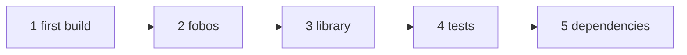

# Tutorials

The tutorials follow one project, `quad`: a small library of quadrature rules (the trapezoidal and Simpson rules) and
a program that uses it. It starts as three source files and no build script, and grows track by track: modes, a
library, tests, dependencies, then verified numerical results, a linted and reviewed code, and an AI assistant that
works under the same checks.

Each track is a sequence of chapters, from the simplest to the most demanding; a track assumes the previous ones.
Every command output shown is the real one: the pages include what the commands printed when
`docs/scripts/docs_examples.py` ran them, and the CI reruns them and fails when an output changes.

## Tracks

| Track | Level | You learn |
|---|---|---|
| [1. First steps](./first-steps/01-first-build) | basic | build without configuration, a fobos with modes, a library, tests and coverage, dependencies |
| [2. Growing a project](./growing/01-templates) | intermediate | templates and variables, build profiles and feature flags, external libraries (MPI, OpenMP), rules, the cache, CI with machine-readable output, fpm and Makefile export |
| [3. Many repositories](./ecosystem/01-register) | intermediate | an ecosystem of projects: dashboard, commands across all of them, checking the projects downstream, the release train |
| 4. Code quality | advanced | the linter, baselines and fixes, reviewing a change, querying the code, verified modernisation, C and Python bindings |
| 5. Verified numerics | advanced | cases and references, shadow builds and the compiler matrix, error and uncertainty assessment, differential runs, benchmarks, the gate, clusters, profiling |
| 6. AI-assisted development | expert | a local model, explained failures, questions answered from the sources, generated tests, merge conflicts, an agent working under the gate |

Tracks 4 to 6 are being written; until then, the [guides](/guide/topics) cover their subjects.

### 1. First steps

| Chapter | You learn |
|---|---|
| [1. A first build](./first-steps/01-first-build) | `fobis build` with no configuration: source discovery, dependency order, incremental rebuilds |
| [2. A fobos file](./first-steps/02-fobos) | modes, `--mode`, build directories, `fobis run` |
| [3. A library](./first-steps/03-library) | static and shared libraries, `fobis install`, linking an installed library |
| [4. Tests](./first-steps/04-tests) | `fobis test`, doctests, coverage |
| [5. Dependencies](./first-steps/05-dependencies) | `[dependencies]`, `fobis fetch`, the lock file |



### 2. Growing a project

| Chapter | You learn |
|---|---|
| [1. Templates and variables](./growing/01-templates) | `template`, `$variables`, `fobis introspect` |
| [2. Build profiles and features](./growing/02-profiles) | `build_profile`, `[features]`, `cflags_heritage` |
| [3. OpenMP and MPI](./growing/03-parallel) | `openmp = True`, `mpi = True` |
| [4. A project that depends on quad](./growing/04-dependon) | `dependon`, interface changes followed |
| [5. Rules](./growing/05-rules) | `[rule-NAME]`, `pre_build`/`post_build`, intrinsic rules, `--jobs` |
| [6. Continuous integration](./growing/06-ci) | `fobis check`, `--json`, a CI workflow |
| [7. Other build systems](./growing/07-export) | `fobis fpm export`, `--makefile` |

### 3. Many repositories

| Chapter | You learn |
|---|---|
| [1. An ecosystem](./ecosystem/01-register) | the registry, `discover`, `add`, `graph` |
| [2. The dashboard](./ecosystem/02-dashboard) | releases due, CI, drift, stale pins; JSON and HTML |
| [3. Acting on every project](./ecosystem/03-exec) | `exec`, `fetch`, in release order |
| [4. Before releasing](./ecosystem/04-check) | `check` (dependents against a working copy), `impact` |
| [5. Shared boilerplate](./ecosystem/05-scaffold) | `scaffold status` and `sync` |
| [6. The release train](./ecosystem/06-release) | `release`: plan, pre-flight, release in order |

## Running the examples yourself

The project of each chapter is in
[`docs/examples/tutorial`](https://github.com/szaghi/FoBiS/tree/master/docs/examples/tutorial): the `files/` of a
chapter are what it adds or changes, its `session.sh` the commands it runs. To rerun them all:

```bash
python docs/scripts/docs_examples.py          # regenerates docs/examples/output
python docs/scripts/docs_examples.py --check   # compares with the committed outputs
```

The outputs were produced with gfortran 13, the compiler of the CI; `DOCS_FC=gfortran-14` runs them with another.
